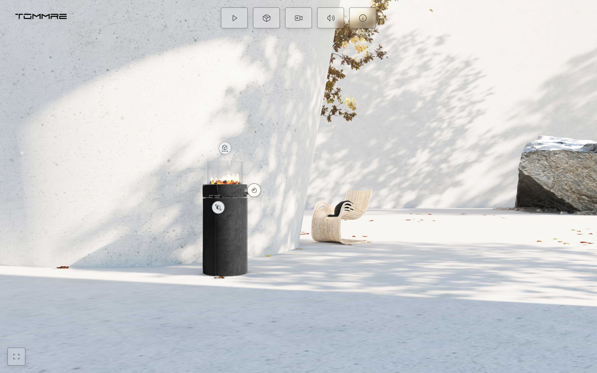
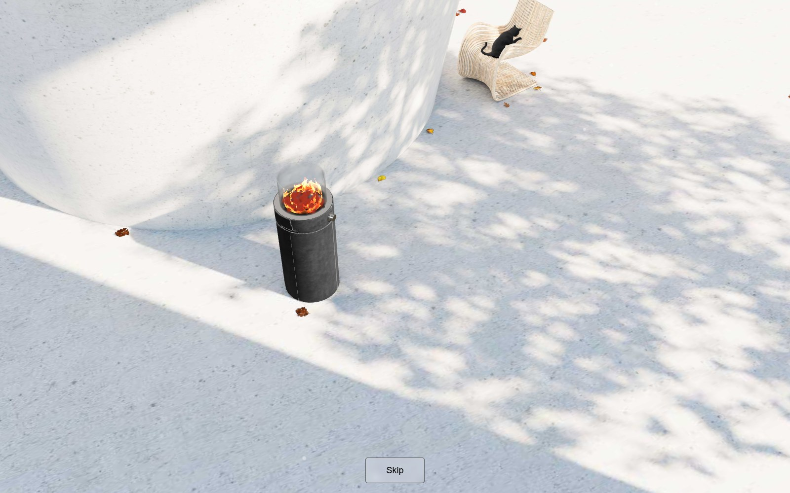
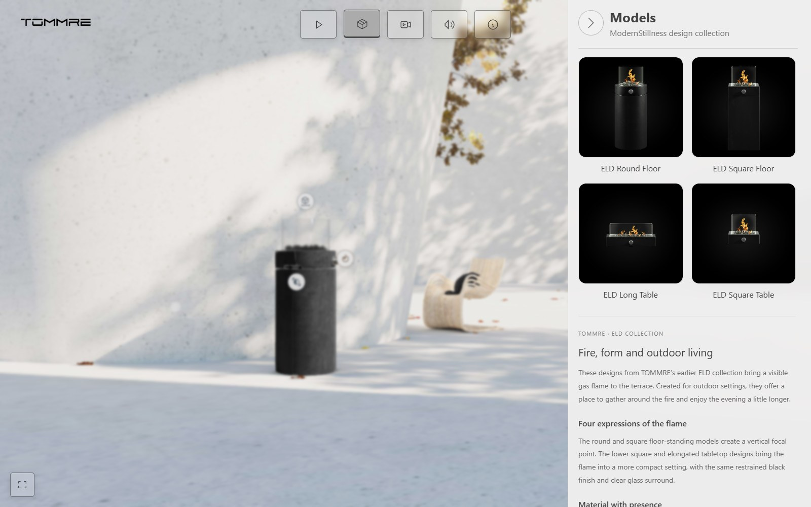
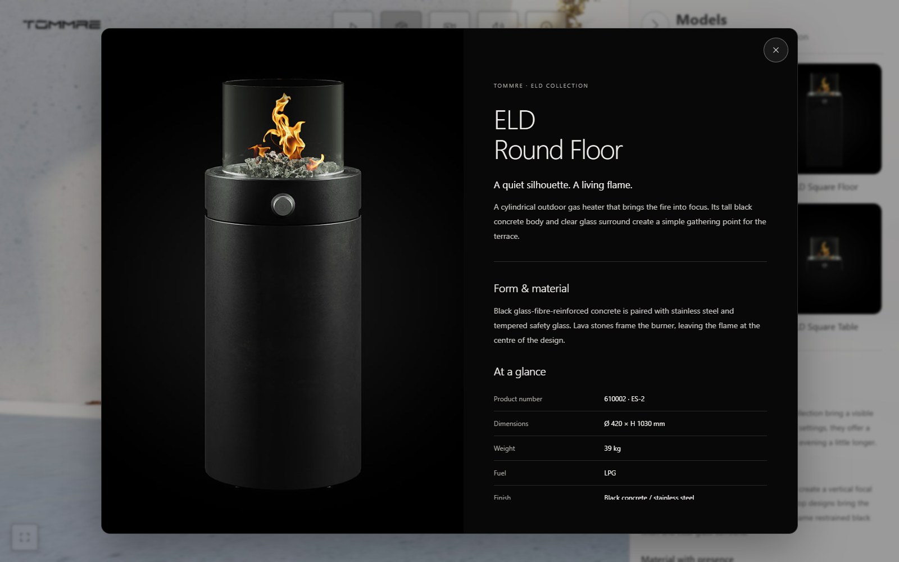
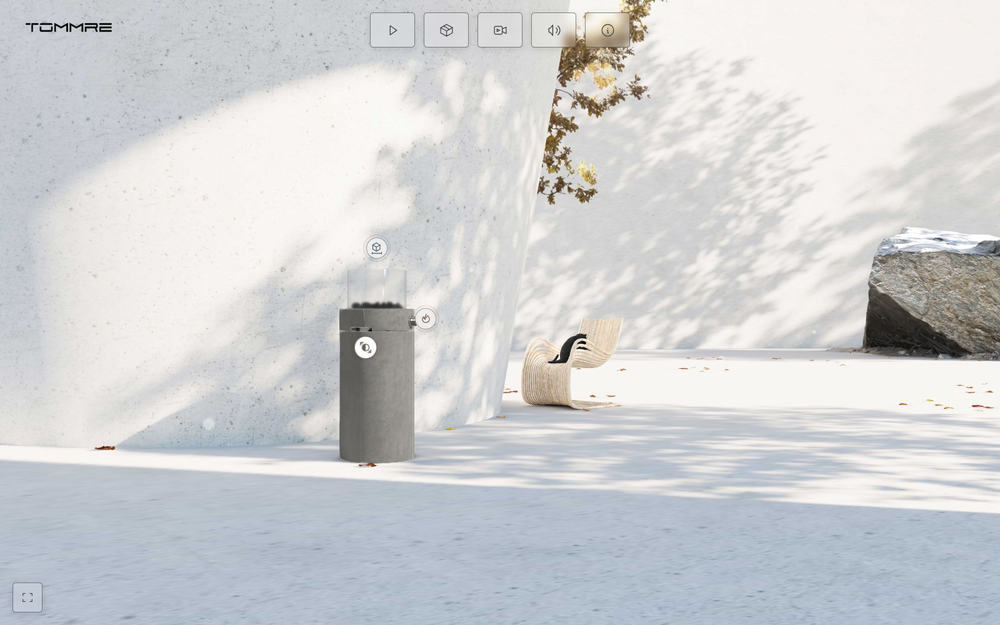
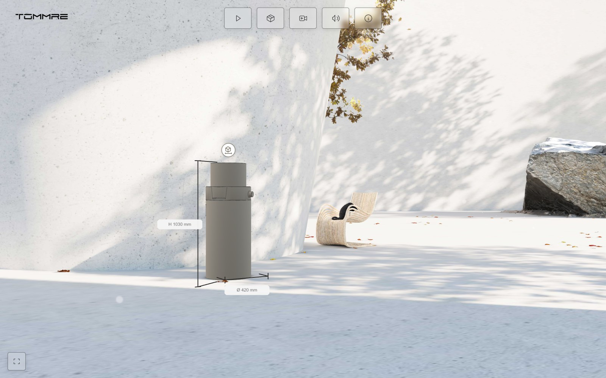
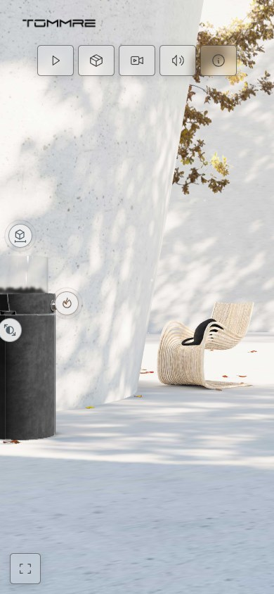
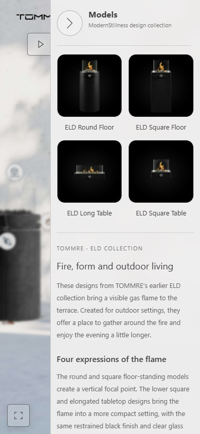

# ModernStillness — Architectural Atmosphere & Interactive Product Storytelling

### $\color{red}\mathbf{0.5\ seconds}$

**Approximately half a second to initial opening — a standout feature of ModernStillness.**

*Based on the author's recent measurements. Initial opening is distinct from full scene readiness; results vary with device, connection and cache.*

[**Explore the live experience →**](https://modernstillness.nourtin.com/) · [Nour Altinawi / Nourtin](https://nourtin.com/)

An interactive terrace experience combining **architectural atmosphere, cinematic camera movement and product exploration** in the browser.

**Role:** Real-time 3D development, material and lighting presentation, camera choreography, responsive interface design and product interactions.

**Platform:** Desktop and mobile web.

**Built with:** Three.js / WebGL, JavaScript, Vite, HTML and CSS.

## The project

ModernStillness presents an outdoor terrace as an environment to experience, rather than a single fixed image. Visitors can move around the space, explore a featured heater, compare its appearance and open a collection of related product presentations.

The visual direction combines quiet architecture, textured surfaces, reflective glass and metal, surrounding greenery and restrained controls. Fire, ambient sound, falling leaves, dust and an animated cat add movement to the setting.

The central design challenge was to bring these layers together while keeping the interface clear: the terrace establishes the atmosphere, the product interactions add detail, and the camera presentation provides a guided route through the scene.

## Experience at a glance

| Area | What the visitor can do |
| --- | --- |
| Terrace exploration | Rotate and zoom around the architectural setting. |
| Cinematic presentation | Watch the opening film or start a separate sequence of composed 3D camera views. |
| Product collection | Browse four ELD product cards in the Models drawer. |
| Product stories | Open larger product images, descriptions, specifications and manufacturer links. |
| Finish comparison | Switch the featured heater between its original appearance and a light concrete interpretation. |
| Clay inspection | Examine the heater with a neutral finish, edge outlines and reference dimensions. |
| Atmosphere | Toggle the fire and control sound while exploring the scene. |
| Mobile viewing | Navigate with touch controls, compact panels and fullscreen where supported. |

## 1. Establish the atmosphere

The terrace gives the product a visual context: architecture, furniture, rocks and vegetation frame the heater within a composed outdoor space. Surface detail and reflections support the material presentation, while animated elements keep the scene from feeling frozen.

The opening film introduces the setting. A soft visual transition and gradual audio entrance connect the loading screen to the film, with a black backing that prevents the 3D scene from showing through during the transition.

Once inside the viewer, visitors can choose their own viewpoint or follow the separate camera demo.

## 2. Browse the product collection

The Models drawer brings four product presentations into a compact two-by-two grid. Names sit below the images, keeping the collection easy to scan without covering the products.

The drawer opens beside the scene and uses a clear back control. This gives visitors a way to browse the collection while keeping its architectural setting in view.

## 3. Move from a preview to a product story

Selecting a card opens a larger, image-led presentation. On desktop, the product occupies the left side while white typography on a dark background introduces the information on the right.

The scrollable content includes product-specific descriptions, specifications and manufacturer links. An additional official outdoor photograph accompanies the round floor model. On smaller screens, the image and information stack vertically.

These cards present information about the collection; they do not replace the heater model in the terrace.

## 4. Compare appearance and inspect form

The featured heater offers two complementary ways to explore its design.

The finish control compares the original body appearance with a lighter concrete interpretation. Glass, metal and fire retain their separate presentation, allowing the visitor to focus on the body finish within the same setting.

*The light finish is a visual approximation derived from the existing baked appearance. It is not a manufacturer-verified material option or a separate physically calibrated finish.*

Clay mode replaces the heater's material presentation with a warm neutral finish and restrained edge outlines. Height and diameter annotations provide an additional reference for reading its proportions.

*The 1030 mm height and 420 mm body diameter are manufacturer reference values for the ELD Round Floor ES-2, article 610002, from the [official instructions](https://www.tommre.se/_files/ugd/76084c_b39ce9f0ec884ed7a152b18175c38b10.pdf). They are reference annotations, not measurements of a physically calibrated 3D model.*

## 5. Guide the eye with camera movement

The camera demo links five composed views with brief transitions through black. Each movement runs for ten seconds, balancing an overview of the setting with closer readings of the featured product and surrounding space.

The sequence uses a dedicated **Skip** control. Skipping returns to the camera position and viewing target used before the demo, so visitors can continue their own exploration.

The guided sequence complements free navigation: one establishes a visual rhythm, while the other gives the visitor control over what to inspect.

## 6. Keep the experience usable on mobile

The interface adapts to portrait and landscape viewports. Touch rotation and zoom support direct navigation; the Models drawer and product details adapt to the available space.

The viewer also offers fullscreen where supported and requests landscape orientation when the browser permits it.

  
  &nbsp;&nbsp;
  

*Mobile captures use browser viewport emulation. They demonstrate the responsive layout, not physical-phone performance.*

## Experience quality

Fast initial opening is a central focus of the project. The author reports approximately **0.5 seconds** in recent measurements of the opening stage. This observation describes the initial opening, not completion of all 3D assets or readiness for every interaction, and is not a cross-device benchmark.

The startup separates the opening interface and movie readiness from preparation of the interactive scene and later effects. Scene rendering pauses behind the film and when the page is hidden. Optional content can fail without making the prepared core scene unusable.

Adaptive rendering quality and technical session measurements support continued refinement across different viewing conditions. Loading time and frame rate depend on the device, browser, connection and cache; this presentation makes no universal timing or FPS claim.

## My contribution

- Developed the browser-based 3D experience and its scene interactions.
- Refined the material, lighting and atmospheric presentation.
- Composed and implemented the multi-clip camera demo and its return behavior.
- Connected the opening film, sound and scene with controlled transitions.
- Designed the Models drawer and image-led product detail layouts.
- Added body-finish comparison and Clay inspection with reference dimensions.
- Adapted controls and content for desktop, portrait and landscape layouts.
- Improved loading behavior, recovery and runtime performance monitoring.

The project brings together **architectural visualization, frontend interaction design and real-time product storytelling**.

## Why it matters

A product can be understood through its setting, appearance, proportions and supporting information. ModernStillness brings these views into one experience: visitors can see the heater in context, inspect its form and read about the wider collection without moving between separate tools.

This is an independent portfolio demonstration of that approach. It does not claim measured commercial outcomes or an official commission from TOMMRE.

## Try the experience

1. Enter the terrace and explore the setting.
2. Open **Models** and select a product card.
3. Compare the heater's body finishes, then try **Clay mode and dimensions**.
4. Start **Demo** for the guided camera sequence; use **Skip** to return to your previous view.

[**Open ModernStillness →**](https://modernstillness.nourtin.com/)

---

**About this repository:** A public portfolio presentation containing descriptions and screenshots captured from the published application on 28 October 2026. Application source, models, original asset packages, development diagnostics and private operational documentation are excluded. Images are actual browser captures compressed for this page. Product imagery and manufacturer information visible inside the captured interface belong to their respective owners. Feature availability and fullscreen behavior depend on the viewing environment.

Browser 3D experience by [Nour Altinawi — Nourtin](https://nourtin.com/). Featured product design and TOMMRE branding belong to their respective owners.
